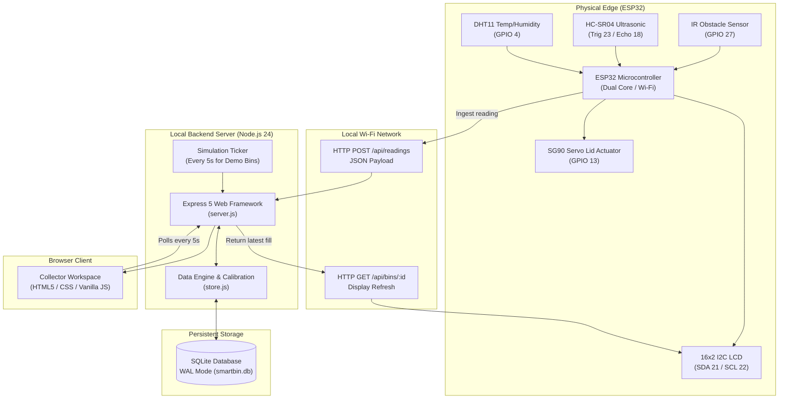
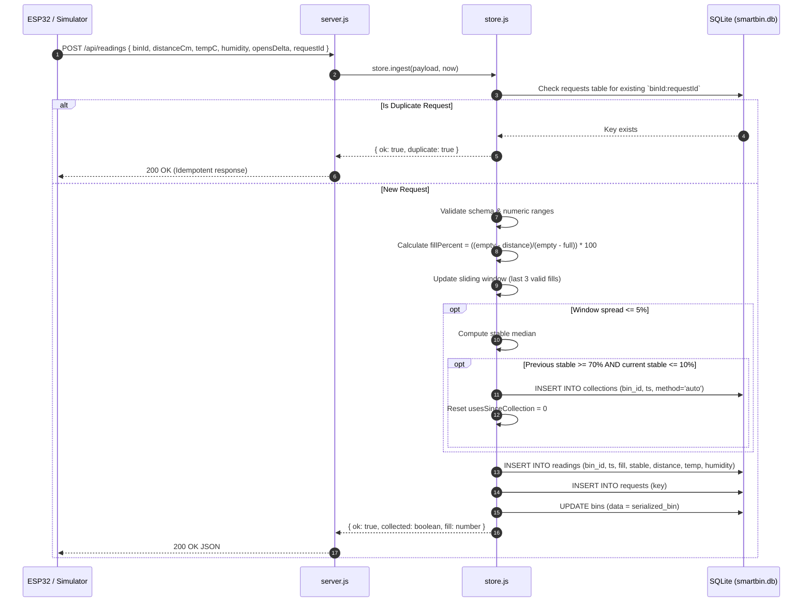

# System Architecture & Design

This document details the architectural design of the **Smart Dustbin** system, including the end-to-end data pipeline, the dual-loop physical execution model, and the local-first software stack.

---

## 1. System Overview

The system is designed as an edge-assisted, local-first IoT waste monitoring architecture. It serves two distinct personas:
1. **Bin Users**: Experience touchless, hygienic waste disposal via responsive local sensors and actuators.
2. **Waste Collectors / Facilities Staff**: Monitor campus waste levels, fill velocity, and collection history through a local real-time web dashboard.

---

## 2. Physical Edge: Dual-Loop Execution Model

To prevent network latency or Wi-Fi outages from blocking lid operation, the ESP32 firmware operates using two decoupled loops:

```mermaid
flowchart TD
    subgraph LocalLoop ["Loop 1: Fast Responsive Lid Control (Interrupt / High Priority)"]
        L1[Read IR Sensor GPIO 27] --> L2{Hand Detected?}
        L2 -- Yes --> L3[Open SG90 Servo to 90°]
        L3 --> L4[Maintain open while hand present]
        L4 --> L5{Hand cleared?}
        L5 -- Yes --> L6[Wait 3s Clear Delay]
        L6 --> L7[Close SG90 Servo to 0°]
        L7 --> L8[Increment opensDelta by 1]
        L8 --> L9[Enforce 2s Cooldown]
    end

    subgraph DataLoop ["Loop 2: Asynchronous Telemetry & Network Sync (5-10s Interval)"]
        D1{Lid Closed & Settled?} -- No --> D2[Set distanceCm = null]
        D1 -- Yes --> D3[Sample 5 HC-SR04 readings\nCompute Median]
        D2 --> D4[Read DHT11 Temp & Humidity]
        D3 --> D4
        D4 --> D5[Bundle Payload:\nbinId, distanceCm, tempC, humidity, opensDelta, requestId]
        D5 --> D6[Send POST /api/readings]
        D6 --> D7{HTTP 200 Received?}
        D7 -- Success --> D8[Reset opensDelta = 0\nUpdate LCD with response fill]
        D7 -- Failure --> D9[Retain opensDelta\nRetry on next cycle]
    end
```

### Safety & Reliability Guarantees:
- **No Blocking on Wi-Fi**: If Wi-Fi disconnects or the server computer reboots, lid operations continue unaffected ([UR08](file:///f:/smart%20dustbin/md/SYSTEM_REQUIREMENTS_SPEC.md#user-requirements)).
- **Acoustic Noise Exclusion**: Distance measurements are **strictly inhibited** while the lid is open or moving to avoid reflections off the opening lid or the user's hand.
- **Median Filter**: HC-SR04 readings take the median of 5 samples to reject ultrasonic scatter.

---

## 3. Server-Side Data Ingestion Pipeline

All readings from both the physical ESP32 bin and simulated demo bins flow through the unified ingestion pipeline in [`dashboard/store.js`](file:///f:/smart%20dustbin/dashboard/store.js):

---

## 4. Subsystem Components & Responsibilities

### 4.1 Backend Engine ([`server.js`](file:///f:/smart%20dustbin/dashboard/server.js))
- Exposes Express REST API routes for querying bins, reading history, and recording collections.
- Serves static dashboard assets ([`index.html`](file:///f:/smart%20dustbin/dashboard/public/index.html), [`app.js`](file:///f:/smart%20dustbin/dashboard/public/app.js), [`style.css`](file:///f:/smart%20dustbin/dashboard/public/style.css)).
- Serves bundled font packages (`@fontsource-variable/manrope` and `@fontsource-variable/space-grotesk`) to guarantee complete functionality offline without internet connectivity.
- Executes background simulation ticker (every 5 seconds) to simulate campus bin activity for testing and demonstrations.

### 4.2 Storage & Domain Layer ([`store.js`](file:///f:/smart%20dustbin/dashboard/store.js))
- Uses Node.js 24's built-in `node:sqlite` module (`DatabaseSync`).
- Runs SQLite with Write-Ahead Logging (`PRAGMA journal_mode=WAL`) for concurrent reader performance and crash resilience.
- Encapsulates database transactions (`BEGIN ... COMMIT / ROLLBACK`) for atomic reading insertion and state updates.
- Houses the mathematical algorithms for fill calibration, 3-reading stability windowing, automatic collection detection, and time-to-full linear projections.

### 4.3 Collector Workspace UI ([`public/app.js`](file:///f:/smart%20dustbin/dashboard/public/app.js))
- Zero-dependency, modern Vanilla JavaScript single-page application (SPA).
- Client-side hash routing (`#overview`, `#bin/:id`, `#collections`).
- Pure SVG dynamic sparkline/trendline generation for fill histories without third-party chart libraries.
- Automatic polling loop every 5 seconds to sync with server state.
- Modal dialogues for sending simulated readings and confirming manual bin collections.
