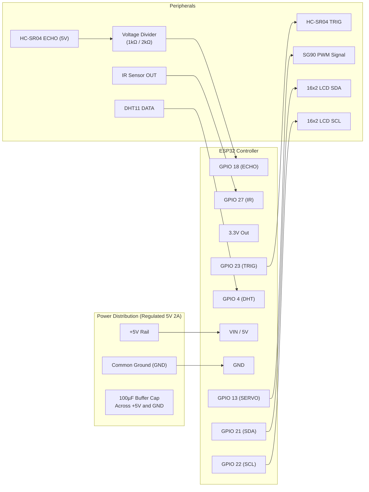

# Hardware Specifications & Circuit Wiring

This guide documents the physical prototype hardware, GPIO pin assignments, electrical level matching, and circuit schematics for the **Smart Dustbin** ESP32 node.

---

## 1. Bill of Materials (BOM)

| Component | Model / Type | Quantity | Voltage | Purpose |
| :--- | :--- | :---: | :---: | :--- |
| **Microcontroller** | ESP32 NodeMCU (30/38 pin) | 1 | 3.3V (5V via USB/Vin) | Central processing, Wi-Fi networking, sensor reading, actuator PWM |
| **Ultrasonic Sensor** | HC-SR04 | 1 | 5V | Measures fill distance from bin top down to waste surface |
| **Proximity Sensor** | Active IR Obstacle Avoidance Module | 1 | 3.3V – 5V | Touchless hand detection to trigger lid opening |
| **Actuator** | TowerPro SG90 Micro Servo (9g) | 1 | 5V (Peak ~500mA) | Opens and closes the dustbin lid mechanism |
| **Climate Sensor** | DHT11 Module | 1 | 3.3V – 5V | Ambient temperature (°C) and relative humidity (%) |
| **Display** | 1602 LCD with PCF8574 I2C Backpack | 1 | 5V (I2C 3.3V/5V) | On-device status: fill %, temp, humidity, Wi-Fi status |
| **Power Supply** | Regulated 5V DC (2A recommended) | 1 | 5V | Dedicated power rail for ESP32, Servo, LCD, and sensors |
| **Level Shifter / Divider** | Resistors (1kΩ, 2kΩ) or Bi-directional LLC | 1 set | — | Steps down HC-SR04 ECHO 5V signal to ESP32-safe 3.3V |
| **Decoupling Capacitor** | 100µF – 470µF Electrolytic | 1 | 16V+ | Buffers 5V rail against voltage sags during servo movement |

---

## 2. ESP32 Pin Allocation Table

| Component | Pin Label | ESP32 GPIO | Direction | Signal Type | Electrical Notes |
| :--- | :--- | :---: | :---: | :--- | :--- |
| **HC-SR04** | TRIG | **GPIO 23** | Output | Digital Pulse (10µs) | 3.3V logic is recognized as HIGH by HC-SR04. |
| **HC-SR04** | ECHO | **GPIO 18** | Input | Digital Echo Width | **CRITICAL**: 5V output from sensor. Must pass through a **voltage divider** to produce ~3.3V before entering GPIO 18. |
| **IR Obstacle** | OUT | **GPIO 27** | Input | Digital (Active LOW) | Connected directly. Calibrate onboard potentiometer for 5–15 cm range. |
| **DHT11** | DATA | **GPIO 4** | Bidirectional | 1-Wire Digital | Connect to 3.3V rail. Requires 4.7kΩ pull-up resistor if using bare sensor. |
| **SG90 Servo**| PWM (Orange) | **GPIO 13** | Output | 50Hz PWM Signal | Signal directly from GPIO 13. Power (Red) **must** come from 5V rail, not ESP32 3V3 pin. |
| **I2C LCD** | SDA | **GPIO 21** | Bidirectional | I2C Data | Default ESP32 hardware I2C SDA pin. |
| **I2C LCD** | SCL | **GPIO 22** | Output | I2C Clock | Default ESP32 hardware I2C SCL pin. |

---

## 3. Electrical Schematic & Wiring Diagram



### 3.1 Voltage Divider for HC-SR04 ECHO
The HC-SR04 outputs a 5V signal on its `ECHO` pin when powered by 5V. Directly connecting this to the ESP32 (which has a 3.6V absolute maximum rating) will damage the GPIO over time.

Use a simple 2-resistor voltage divider:
```text
HC-SR04 ECHO (5V) ───────┬──────── [R1: 1.0 kΩ] ───────┬───────> ESP32 GPIO 18 (~3.3V)
                         │                             │
                        GND                    [R2: 2.0 kΩ]
                                                       │
                                                      GND

Formula: V_out = 5V * (2000 / (1000 + 2000)) = 3.33 V
```

### 3.2 Servo Power & Brownout Mitigation
- **Never power the SG90 servo from the ESP32 `3V3` pin.** The onboard LDO regulator on the ESP32 dev board cannot supply the 500mA+ stall current of the motor. Doing so causes the ESP32 to brown out and continuously reboot.
- Power the servo directly from the external **5V rail**.
- Place a **100µF – 470µF electrolytic capacitor** directly across the servo's `+5V` and `GND` lines to absorb instantaneous current spikes when the motor begins spinning.

---

## 4. Mechanical & Sensor Calibration

### 4.1 Ultrasonic Fill Distance Calibration
The system translates physical distance ($d$ in cm) into a fill percentage using calibrated boundaries:

```text
               ┌── [HC-SR04 Sensor mounted under bin lid / top rim]
               │
    d = 5 cm   ▼ ════════════════════════════════════════════════════ (100% Full Level)
               ░
               ░   Usable Fill Range: 35 cm total depth
               ░
    d = 40 cm  ▼ ──────────────────────────────────────────────────── (0% Empty Floor)
```

- **Empty Distance ($E$)**: `40.0 cm` (distance from sensor face to the clean bottom of the bin)
- **Full Distance ($F$)**: `5.0 cm` (closest permitted waste level before risk of blocking the lid)
- **Blind Zone Warning**: The HC-SR04 has an acoustic blind zone of roughly **2 cm – 3 cm**. Setting full distance to $5\text{ cm}$ guarantees the sensor remains outside its blind zone even when full.
- **Beam Angle**: The HC-SR04 has an effective measuring angle of approximately $15^\circ$. Ensure the sensor is centered so pulses do not reflect off the bin sidewalls.

### 4.2 Servo Angles & Linkage Setup
- **Closed Angle**: Typically configured between $0^\circ$ and $10^\circ$ (depending on mechanical horn mounting).
- **Open Angle**: Configured between $85^\circ$ and $95^\circ$ to fully swing the lid open.
- **Safety**: Do not drive the servo past its mechanical end-stops. Always test angles without the linkage attached first to establish exact travel endpoints.

---

## 5. Firmware Timing & State Engine Parameters

| Parameter | Recommended Value | Specification Reference | Notes |
| :--- | :---: | :---: | :--- |
| **Lid Clear Delay** | `3000 ms` | [FR02](file:///f:/smart%20dustbin/md/SYSTEM_REQUIREMENTS_SPEC.md#fr02-lid-stay-open-and-clear-delay) | Wait duration after hand leaves IR field before beginning lid closure |
| **Lid Cooldown** | `2000 ms` | [FR02](file:///f:/smart%20dustbin/md/SYSTEM_REQUIREMENTS_SPEC.md#fr02-lid-stay-open-and-clear-delay) | Prevents immediate jitter or re-triggering right after closure |
| **Ultrasonic Settling** | `2000 ms` | [FR04](file:///f:/smart%20dustbin/md/SYSTEM_REQUIREMENTS_SPEC.md#fr04-ultrasonic-fill-measurement) | Delay after lid closure before taking ultrasonic readings (allows waste/dust/air turbulence to settle) |
| **Ultrasonic Samples** | `5 samples` | [FR04](file:///f:/smart%20dustbin/md/SYSTEM_REQUIREMENTS_SPEC.md#fr04-ultrasonic-fill-measurement) | 5 raw distance pings taken 50ms apart; median value selected to eliminate transient outliers |
| **Telemetry Send Interval** | `5000 – 10000 ms` | [FR06](file:///f:/smart%20dustbin/md/SYSTEM_REQUIREMENTS_SPEC.md#fr06-telemetry-frequency) | Regular polling and HTTP POST upload cadence to Node.js backend |
